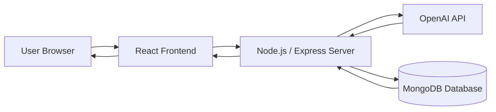

# 🍳 AI-Powered Recipe Generator

<p align="center">

</p>

<p align="center">

</p>

<p align="center">

</p>

---

# 🚀 Project Overview

**AI-Powered Recipe Generator** is an intelligent web application that generates recipes based on the ingredients available with the user.

Users can instantly generate AI-powered recipes, save their favorite dishes, and share them with the community.

The project is built using the **MERN Stack (MongoDB, Express.js, React, Node.js)** and integrates the **OpenAI API** for smart recipe generation.

---

# 🧠 Project Architecture



---

# ✨ Features

- 🤖 AI-powered recipe generation using OpenAI
- 🥗 Generate recipes based on available ingredients
- ⭐ Save and manage favorite recipes
- 🌍 Community recipe sharing
- 📱 Fully responsive modern UI
- ⚡ Fast backend API with Node.js
- 🗄️ MongoDB database integration

---

# 📸 Application Screenshots

## 🏠 Welcome Page


---

## 🍲 Recipe Generator Page


---

## ℹ️ About Page


---

# 🏗️ Tech Stack

### Frontend
- React.js  
- CSS / Tailwind CSS  
- Axios  

### Backend
- Node.js  
- Express.js  

### Database
- MongoDB  

### AI Integration
- OpenAI API  

---

# 📂 Project Structure

```
AI-Recipe-Generator
│
├── client
│   ├── components
│   ├── pages
│   ├── App.js
│   └── package.json
│
├── server
│   ├── routes
│   ├── controllers
│   ├── models
│   └── index.js
│
├── .env
└── README.md
```

---

# ⚙️ Installation & Setup

## 1️⃣ Clone the Repository

```bash
git clone https://github.com/yourusername/ai-recipe-generator.git
cd ai-recipe-generator
```

---

## 2️⃣ Install Dependencies

```bash
npm install
cd client
npm install
```

---

## 3️⃣ Create `.env` File

```
MONGODB_URI=your_mongodb_uri
OPENAI_API_KEY=your_openai_api_key
PORT=5000
```

---

## 4️⃣ Run the Application

```bash
npm run dev:full
```

Server will run at:

```
http://localhost:5000
```

---

# 🚀 Deployment

## Backend Deployment (Heroku / Render)

```bash
heroku login
heroku create your-app-name
git push heroku main
```

Set environment variables:

```
MONGODB_URI
OPENAI_API_KEY
```

---

## Frontend Deployment (Netlify)

**Build Command**

```
cd client && npm run build
```

**Publish Directory**

```
client/build
```

---

# 🤝 Contributing

Contributions are welcome!

1. Fork the repository  
2. Create a new branch  
3. Commit your changes  
4. Push to GitHub  
5. Open a Pull Request  

---

# 👨‍💻 Author

**Ranbir Singh**

💼 MERN Stack Developer  
📍 Bangalore, India  

📧 ranbirsingh9156@gmail.com  

🔗 GitHub  
https://github.com/RanbirProjects  

🔗 LinkedIn  
https://linkedin.com/in/ranbirsingh14  

---

# 📜 License

This project is licensed under the **MIT License**.
